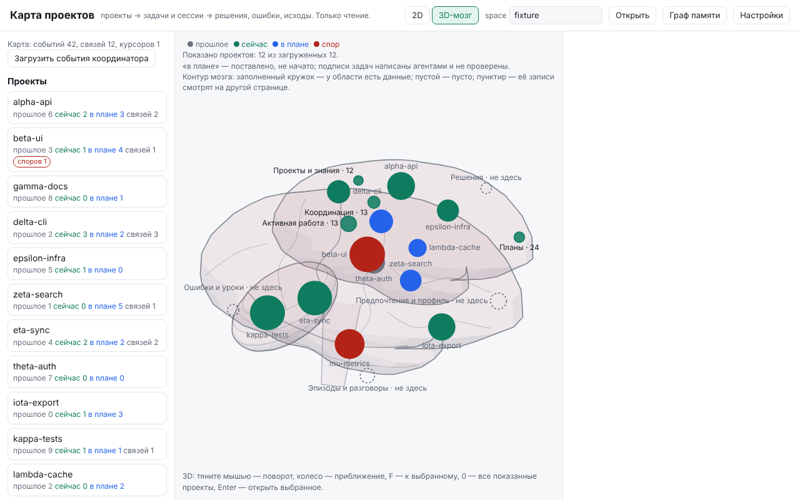

# Brain ED




На снимке — двенадцать искусственных проектов. Это пример карты проектов,
а не подтверждение работы сети компьютеров или полного архива переписок.
[English version](README.md)

**0.1.4 — ранний предварительный выпуск. Только Linux x86_64.** Готовый
архив нужной версии можно использовать, если он указан на
[странице выпусков](https://github.com/vavavadusik-crypto/brain-ed/releases).
Архив устанавливает ту версию, из которой собран. Если подходящего архива
нет, соберите программу из исходников.
[Проверки и ограничения](docs/release-0.1.4-verification.md).


Brain ED — локальная личная память и координация задач для ИИ-агентов,
написанная на Rust поверх SQLite. Команда и пакет называются `brain`. Веса
моделей, ключи провайдеров и личные архивы в исходники не входят.

## Что это

- **Личная память владельца.** Однопользовательская SQLite-база
  (`~/.brain/brain.sqlite`): записи с авторством и двумя осями времени, поиск
  BM25 + точные сущности, необязательный векторный поиск, граф кода
  (`brain index`).
- **Граф и обозреватель памяти.** `brain ui --page graph` открывает страницу
  только на loopback.
- **Карта работы (`/map`).** 2D/3D-карта проектов с обзором «мозга» из восьми
  областей. Числа есть только у «Проекты и знания», «Активная работа», «Планы»
  и «Координация» и только для загруженной страницы проектов; остальные области
  пишут «не здесь» и ведут в граф или архив. Области — способ разложить память,
  а не анатомия.
- **Настройки.** `brain ui` показывает конфигурацию, состояние и активность агентов.
- **Задачи, захваты, аренды.** `brain work …` и MCP-инструменты `work_*`.
  Правки не перехватываются: агент, который не спрашивает, не останавливается.
- **Координатор по TLS.** `brain net …` — протокол `brain-coord/1` по loopback
  TLS с выданными файлами учётных данных `0600`; обмен фактами
  (`brain net share`) по умолчанию запрещён для каждого пространства.
- **Архив переписок.** `brain archive …` хранит видимый текст пользователя и
  ассистента из Claude Code, Codex и Hermes; сбор включается явно.
- **MCP-сервер.** `brain serve` — MCP по stdio JSON-RPC.

## Ограничения (прочтите до использования)

- **Проверено локально, это не парк машин.** Координация и обмен проверены на
  локальных процессах и loopback TLS. Это не доказательство работы реального
  распределённого парка, LAN или готовности для предприятия. Прослушивание в
  LAN есть только как экспериментальная явная настройка: только TLS, один
  частный IP (`brain net serve --listen <IP> --allow-lan`, IP SAN = адрес
  прослушивания = `--server-name` клиента, обязателен firewall оператора);
  см. `docs/network-transport.md`. Для продакшена не подтверждено.
- **Активность заявляется агентами.** Экран активности и «Активная работа»
  показывают то, что агенты сообщили через хуки и захваты. Brain ED не следит за
  экраном, клавиатурой или файлами.
- **Архив неполный.** Для всех трёх клиентов сборщик после включения хранит
  только видимый разрешённый текст сообщений. Рассуждения, вызовы инструментов и
  их вывод отбрасываются. Полная история не гарантируется.
- **Архив личный и глобальный.** Он принадлежит владельцу учётной записи, **не**
  разделён по проектам и **не** имеет ACL проектов. Результаты поиска помечены
  как недоверенные: текст архива — данные, а не инструкции.
- **Числа карты частичные.** Только загруженные проекты и задачи; подсчёт
  записей памяти по областям не реализован.
- **Безопасность не доказана формально.** Границы покрыты тестами, но
  формальной верификации и внешнего аудита нет. См. [SECURITY.md](SECURITY.md)
  и [docs/SECURITY.md](docs/SECURITY.md).

## Установка на Linux x86_64

Оба способа ставят одни и те же два ярлыка — **Brain ED Settings** и
**Brain ED Graph** — в меню приложений, а если есть рабочий стол XDG, то и на
него.

1. **Из исходников (работает уже сейчас).** Нужны Rust и компилятор C; см.
   раздел ниже.
2. **Готовый архив (только если он есть в нужном выпуске).** Откройте этот
   выпуск на странице *Releases* репозитория на GitHub. Если в нём есть файл
   `brain-ed-<версия>-linux-x86_64.tar.gz`, им можно воспользоваться; если
   нет — собирайте из исходников. Архив устанавливает ту версию, из которой
   собран; выбирайте архив нужного выпуска.
   Архиву не нужен Rust: распакуйте его, запустите
   `./install-linux.sh --dry-run`, затем `./install-linux.sh`.
   Бинарник собран динамически под glibc. Сборка ручным workflow идёт на
   Ubuntu 24.04 (glibc 2.39), а `MANIFEST.json` записывает нужную версию
   glibc. Другие дистрибутивы не проверялись, переносимость не доказана.
   Контрольные суммы приходят в том же архиве и не подписаны: они ловят
   повреждение файлов, но не подтверждают подлинность архива и не доказывают,
   кто его собрал. Подробности: [docs/linux-download.md](docs/linux-download.md).

Ни один способ не подключает агентов, сборщик архива, сетевой слушатель и не
скачивает модель. Это отдельные явные шаги, например
`brain init --agents --dry-run`, а после проверки — `--yes` (см.
[docs/INSTALL.md](docs/INSTALL.md)). Если `CLAUDE_CONFIG_DIR` или `CODEX_HOME`
указывает не на стандартный каталог, Brain не настраивает этого клиента и
выводит строку `CONFLICT` с именем переменной и состоянием, без её значения.
Перенесённые каталоги не поддерживаются; для Hermes нет интеграции MCP и
хуков. Подробнее: [docs/mcp-and-hooks.md](docs/mcp-and-hooks.md).

## Установка из исходников (Linux)

Нужно: Rust через rustup (точная версия закреплена в `rust-toolchain.toml`,
edition 2024), компилятор C для встроенной SQLite, `python3` — только для
необязательных инструментов архива.

```console
git clone https://github.com/vavavadusik-crypto/brain-ed.git && cd brain-ed
./install.sh --dry-run     # только план: ничего не собирает и не пишет
./install.sh               # cargo build --locked --release -p brain-cli + ярлыки
./install.sh --uninstall   # удаляет ярлыки; ~/.brain сохраняется
```

Подробности и поведение ярлыков: [docs/INSTALL.md](docs/INSTALL.md).

После установки добавьте стабильную копию в текущую сессию терминала:

```sh
export PATH="$HOME/.brain/bin:$PATH"
```

## Быстрые команды

Примеры на синтетических данных. Точный список — `brain --help` и
`brain <команда> --help`.

```console
brain init
brain remember "Сборка идёт через cargo --locked" --kind decision --tag build
brain recall "cargo locked"
brain status
brain doctor
brain ui
brain ui --page graph
brain work board --ready
brain archive status
brain init --agents --dry-run
brain model install            # необязательно: явная загрузка эмбеддингов
```

## Лицензия

Apache-2.0 (см. [LICENSE](LICENSE)). Сторонние компоненты — под своими
лицензиями, см. [THIRD_PARTY_NOTICES.md](THIRD_PARTY_NOTICES.md).

Проверки и точные ограничения версии 0.1.2: [docs/VALIDATION.md](docs/VALIDATION.md).
Проверки исходников 0.1.4 и их границы: [docs/release-0.1.4-verification.md](docs/release-0.1.4-verification.md).

[3D-граф памяти: управление, области и ограничения](docs/graph-explorer.md) · [Экспериментальное чтение удалённого MCP](docs/remote-mcp.md)


Явные профили клиентов: `brain clients register` записывает каталог клиента.
Для зарегистрированного Codex команда `brain clients configure` отдельно
подключает MCP. Одна регистрация не подключает клиент и не включает захват.
См. [профили клиентов](docs/client-profiles.md) и
[подключение Codex MCP](docs/registered-codex-mcp.md).
